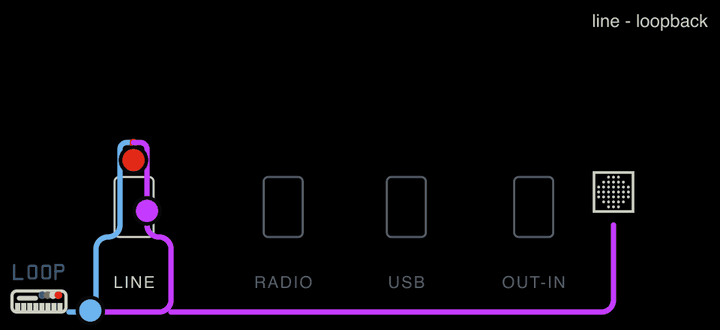

# Loopback

USB loopback in three states for the OP-1 Field, as an [open-field](https://github.com/LaP0573/open-field) pack for
OS 1.7.3 (open-field 0.12 or later).

Unofficial. Not made, endorsed or supported by Teenage Engineering, and not affiliated with them or with open-field.
Use at your own risk; see [LICENSE](LICENSE).

## Install

On open-field's [install page](https://lap0573.github.io/open-field/), open the packs section and tick **loopback**
(once listed). Or put `loopback.pack` from this repository into the unit's `packs` folder next to `base.pack` and
restart. Hold **Help** while switching on to start without packs.

## Use

On the input screen, click the blue knob to step through the states. They apply with USB or line as the input.

| State | USB carries | The Field plays | The tape records |
| --- | --- | --- | --- |
| loopback | everything, the return too | everything, the return too | the synth and the return |
| wet+dry | everything but the return | everything, and the return | the synth and the return |
| wet | the dry synth alone | everything but the dry synth, and the return | the return |

- Click the gray knob to keep the speaker on with a cable in the jack.
- In wet, set your effect to 100% wet to hear only what comes back.
- With the amp engine on the synth, the amp's sound is the return: wet+dry keeps it out of USB, and wet sends it
  alone, so the Field works as an amp for the computer. The Field plays it in both.

## Build

Set `OPEN_FIELD`, `OPEN_XY` and `TOOLCHAIN` in `local.env` ([open-xy](https://github.com/etcetc000/open-xy) provides
the toolchain), then run `./build.sh`. The pack is written to `out/loopback.pack`.
